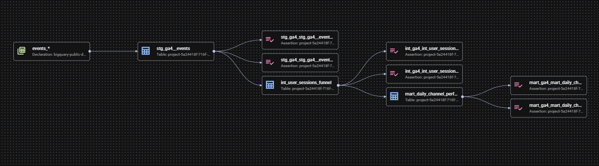
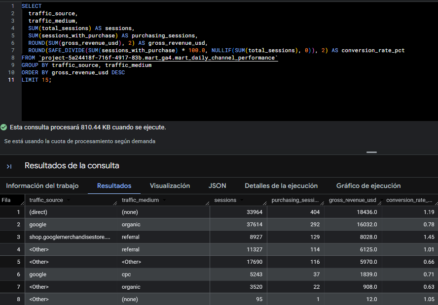

# GA4 E-Commerce & Channel Analytics Engineering Pipeline

[EN Read in English](#en-english-version) | [ES Leer en Español](#es-versión-en-español)

---

## EN English Version

### Overview
This project is an end-to-end Analytics Engineering pipeline built on Google Cloud (BigQuery + Dataform) using the public Google Analytics 4 (`ga4_obfuscated_sample_ecommerce`) dataset. Following a layered transformation architecture (**Sources → Staging → Intermediate → Marts**), it unpacks nested GA4 event arrays, deduplicates event streams, models session-level funnel behavior, enforces automated data quality assertions, and optimizes BigQuery storage and query performance through partitioning and clustering.

### Architecture & Data Flow
1. **Sources (`definitions/sources/`):** Declares external raw GA4 event tables (`bigquery-public-data.ga4_obfuscated_sample_ecommerce.events_*`) to track full lineage via `${ref()}`.
2. **Staging (`definitions/staging/`):** Cleans, un-nests, standardizes timestamps/dates, generates deterministic event keys, and deduplicates raw events (`stg_ga4__events`).
3. **Intermediate (`definitions/intermediate/`):** Aggregates event-level records into session-level funnel and monetization tables (`int_user_sessions_funnel`), resolving first-touch attribution and funnel milestones.
4. **Marts (`definitions/marts/`):** Exposes daily reporting tables (`mart_daily_channel_performance`) segmented by channel, device, and country with funnel conversion rates and revenue KPIs.

### Transformation & Data Quality Highlights
The SQLX models in Dataform transform nested event logs into reliable analytics tables while enforcing automated quality checks:
- **Nested Event Unpacking & Standardization:** Extracts key parameters from `event_params` (`ga_session_id`, `ga_session_number`, `page_location`, `page_title`), struct fields (`device`, `geo`, `traffic_source`, `ecommerce`), and converts microsecond timestamps and string dates into native `TIMESTAMP` and `DATE` types.
- **Event Deduplication & Deterministic Keys:** Generates an `MD5` hash key (`event_id`) and applies `QUALIFY ROW_NUMBER()` partitioning to remove duplicate event deliveries caused by tracking retries.
- **Session Attribution & Funnel Modeling:** Rolls up events to `session_id`, extracts chronological first-touch non-null attributes (`ARRAY_AGG(... IGNORE NULLS ORDER BY event_timestamp ASC)[SAFE_OFFSET(0)]`), and flags `view_item`, `add_to_cart`, `begin_checkout`, and `purchase` alongside session revenue and transaction counts.
- **Automated Assertions & Cost Optimization:** Configures `nonNull` and `uniqueKey` assertions on models, and uses `partitionBy` and `clusterBy` in BigQuery to reduce scan costs and improve filtering performance.

### Data Model
The pipeline follows a layered dimensional/mart design in BigQuery:
- **Event & Session Foundation:** `stg_ga4__events` (event grain, partitioned by `event_date`, clustered by `event_name` and `user_pseudo_id`) feeds `int_user_sessions_funnel` (session grain, partitioned by `session_date`, clustered by `traffic_source`, `traffic_medium`, and `country`).
- **Reporting Mart:** `mart_daily_channel_performance` (daily grain by date, source, medium, device, and country, partitioned by `report_date`) computes `view_to_cart_rate_pct`, `cart_to_purchase_rate_pct`, `session_conversion_rate_pct`, `revenue_per_session_usd`, and `avg_order_value_usd` using `SAFE_DIVIDE` and `NULLIF`.

### Project Structure
    ├── README.md
    └── definitions/
        ├── sources/
        │   └── ga4_events.sqlx
        ├── staging/
        │   └── stg_ga4__events.sqlx
        ├── intermediate/
        │   └── int_user_sessions_funnel.sqlx
        └── marts/
            └── mart_daily_channel_performance.sqlx

### Visualizations & Query Insights
- 🔗 **[Dataform Lineage & Execution (docs/dataform_lineage.png)](docs/dataform_lineage.png):** End-to-end dependency graph from `events_*` through `stg_ga4__events` and `int_user_sessions_funnel` to `mart_daily_channel_performance` with passing assertions.

- 🔗 **[Channel Performance Query Results (docs/channel_performance_query.png)](docs/channel_performance_query.png):** Sample BigQuery output from `mart_daily_channel_performance` showing `(direct) / (none)` and `google / organic` leading gross revenue, while `referral` traffic (`shop.googlemerchandisestore...`) achieves strong session conversion (`1.45%`).

---

## ES Versión en Español

### Descripción General
Este proyecto es un pipeline integral de Analytics Engineering construido en Google Cloud (BigQuery + Dataform) sobre el dataset público de Google Analytics 4 (`ga4_obfuscated_sample_ecommerce`). Siguiendo una arquitectura de transformación en capas (**Sources → Staging → Intermediate → Marts**), desanida arreglos de eventos de GA4, deduplica registros, modela embudos y facturación a nivel sesión, aplica pruebas automáticas de calidad (*assertions*) y optimiza costos y tiempos de consulta en BigQuery mediante particionamiento y *clustering*.

### Arquitectura y Flujo de Datos
1. **Fuentes (`definitions/sources/`):** Declara las tablas crudas externas de GA4 (`bigquery-public-data.ga4_obfuscated_sample_ecommerce.events_*`) para mantener el linaje completo mediante `${ref()}`.
2. **Staging (`definitions/staging/`):** Limpia, desanida, estandariza fechas y marcas de tiempo, genera claves determinísticas y deduplica eventos (`stg_ga4__events`).
3. **Intermediate (`definitions/intermediate/`):** Agrega los eventos a nivel sesión (`int_user_sessions_funnel`), resolviendo atribución de primer toque, etapas del embudo e ingresos.
4. **Marts (`definitions/marts/`):** Expone tablas diarias listas para consumo analítico (`mart_daily_channel_performance`) por canal, dispositivo y país con tasas de conversión y métricas de ingreso.

### Destacados de Transformación y Calidad de Datos
Los modelos SQLX en Dataform convierten logs de eventos anidados en tablas confiables mientras validan automáticamente la integridad de los datos:
- **Desanidado y Estandarización de Eventos:** Extrae parámetros clave desde `event_params` (`ga_session_id`, `ga_session_number`, `page_location`, `page_title`) y estructuras (`device`, `geo`, `traffic_source`, `ecommerce`), convirtiendo microsegundos y textos de fecha a tipos `TIMESTAMP` y `DATE`.
- **Deduplicación y Claves Determinísticas:** Calcula un hash `MD5` (`event_id`) y aplica `QUALIFY ROW_NUMBER()` para eliminar duplicados ocasionados por reintentos de envío en el tracking.
- **Atribución por Sesión y Embudo:** Agrupa por `session_id`, toma el primer valor no nulo en orden cronológico (`ARRAY_AGG(... IGNORE NULLS ORDER BY event_timestamp ASC)[SAFE_OFFSET(0)]`) y calcula marcas de `view_item`, `add_to_cart`, `begin_checkout` y `purchase`, junto con ingresos y transacciones por sesión.
- **Assertions Automáticas y Optimización de Costos:** Define validaciones `nonNull` y `uniqueKey` en los modelos, y aplica `partitionBy` y `clusterBy` en BigQuery para reducir el volumen de datos escaneado.

### Modelo de Datos
El pipeline implementa un modelado progresivo en capas dentro de BigQuery:
- **Base de Eventos y Sesiones:** `stg_ga4__events` (grano de evento, particionado por `event_date` y *clustered* por `event_name` y `user_pseudo_id`) alimenta a `int_user_sessions_funnel` (grano de sesión, particionado por `session_date` y *clustered* por `traffic_source`, `traffic_medium` y `country`).
- **Mart de Reporte:** `mart_daily_channel_performance` (grano diario por fecha, origen, medio, dispositivo y país, particionado por `report_date`) calcula `view_to_cart_rate_pct`, `cart_to_purchase_rate_pct`, `session_conversion_rate_pct`, `revenue_per_session_usd` y `avg_order_value_usd` usando `SAFE_DIVIDE` y `NULLIF`.

### Estructura del Proyecto
    ├── README.md
    └── definitions/
        ├── sources/
        │   └── ga4_events.sqlx
        ├── staging/
        │   └── stg_ga4__events.sqlx
        ├── intermediate/
        │   └── int_user_sessions_funnel.sqlx
        └── marts/
            └── mart_daily_channel_performance.sqlx

### Visualizaciones y Resultados de Consulta
- 🔗 **[Linaje y Ejecución en Dataform (docs/dataform_lineage.png)](docs/dataform_lineage.png):** Grafo de dependencias de punta a punta desde `events_*` hacia `stg_ga4__events`, `int_user_sessions_funnel` y `mart_daily_channel_performance` con pruebas en verde.

- 🔗 **[Resultados de Performance por Canal (docs/channel_performance_query.png)](docs/channel_performance_query.png):** Consulta de ejemplo sobre `mart_daily_channel_performance` donde `(direct) / (none)` y `google / organic` lideran los ingresos brutos, mientras que el tráfico de referido (`shop.googlemerchandisestore...`) destaca en conversión por sesión (`1.45%`).

